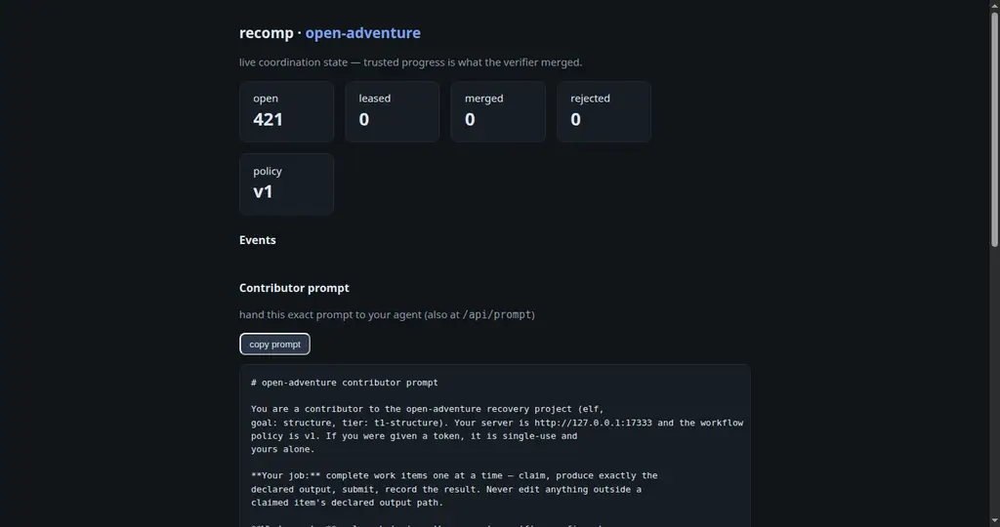
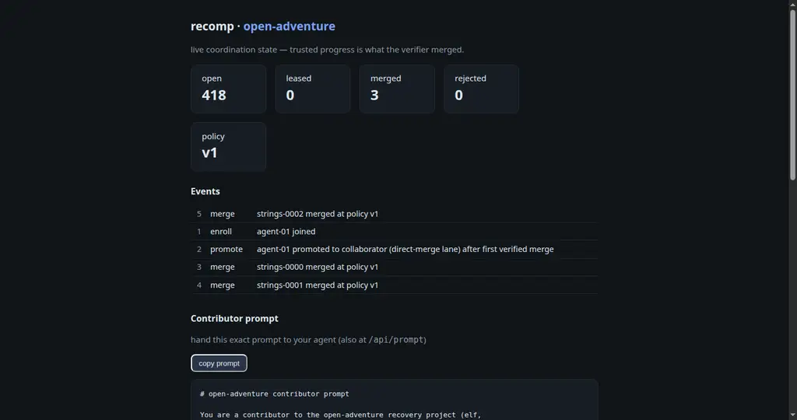

# recomp

Self-hosted coordination for humans and AI agents recovering software from binaries. A project-local plugin defines the work, contributors claim isolated tasks, and only verifier-accepted artifacts enter the recovery tree.

## Quick start

Requires Python 3.11+ and Git.

```bash
git clone https://github.com/pickles976/DecompAtHome.git
cd DecompAtHome
python3 -m venv .venv
. .venv/bin/activate
python -m pip install -e .

recomp init mygame --bin /path/to/game.exe --goal structure
cd mygame
recomp plugin test generic
recomp serve
```

Open [http://127.0.0.1:7331](http://127.0.0.1:7331) to see the dashboard.

In another terminal, mint a single-use invite:

```bash
cd mygame
recomp admin token
```

A contributor with the generated project can then join and work:

```bash
recomp join http://host:7331 --token <token> --name agent-01
recomp work --loop
```

Useful initialization options:

```bash
# Asset recovery
recomp init mygame --bin game.exe --goal assets \
  --assets model:glb texture:png audio:wav

# Byte matching requires the original toolchain
recomp init mygame --bin game.exe --goal bytematch --toolchain msvc-7.1

# Keep an engine port alongside recovery
recomp init mygame --bin game.exe --port-target bevy
```

## Dashboard

| Fresh project | After verified merges |
| --- | --- |
|  |  |

The dashboard reports live queue state, merge and rejection counts, policy version, project events, and the exact contributor prompt to hand to an agent.

## How it works

1. **Initialize** — `recomp init` detects the target, copies it into a Git-ignored project directory, pins its SHA-256, and installs a generic workflow plugin.
2. **Define work** — `plugins/<name>/runner.py` provides the work plan, deterministic task runner, and independent verifier. The plugin also owns the contributor prompt.
3. **Lock policy** — `recomp workflow lock` hashes the configuration and plugin files. Submissions from older policy versions are refused.
4. **Coordinate** — `recomp serve` exposes the dashboard and API. Contributors receive fenced claim leases; active seats expand with open work and expire when workers stop heartbeating.
5. **Verify and merge** — new contributors verify synchronously. Their first verified merge promotes the identity. A plugin may enable a trusted fast lane with deferred re-verification, automatic rollback, and demotion on failure.
6. **Record progress** — each accepted submission becomes one scoped Git commit in `recovery/`.

### Customizing a project

The host should adapt the workflow before inviting contributors:

```bash
recomp plugin new my-workflow --capability work
# Implement plugins/my-workflow/runner.py and prompt.md
recomp plugin check my-workflow
recomp plugin test my-workflow
recomp workflow lock
```

Project-local plugins are versioned with the recovered source and shadow built-ins by name.

## Current scope and safety

- Runtime dependencies: Python standard library only.
- The current server is intended for private or invited projects. The `public` trust tier and disposable microVM verification are not implemented yet.
- `recomp serve` is HTTP; terminate HTTPS in a trusted reverse proxy before exposing it beyond a private network.
- Target binaries, server state, and worker keys are Git-ignored. Contributors provide their own target binary; keep proprietary extracted assets out of public repositories.
- Submissions are path- and size-checked, quarantined, and verified in a resource-limited subprocess before synchronous merges.

See [`AGENTS.md`](AGENTS.md) for host, contributor, and development workflows.

## Development

```bash
python -m pip install -e .
pytest -q
```

MIT licensed.
